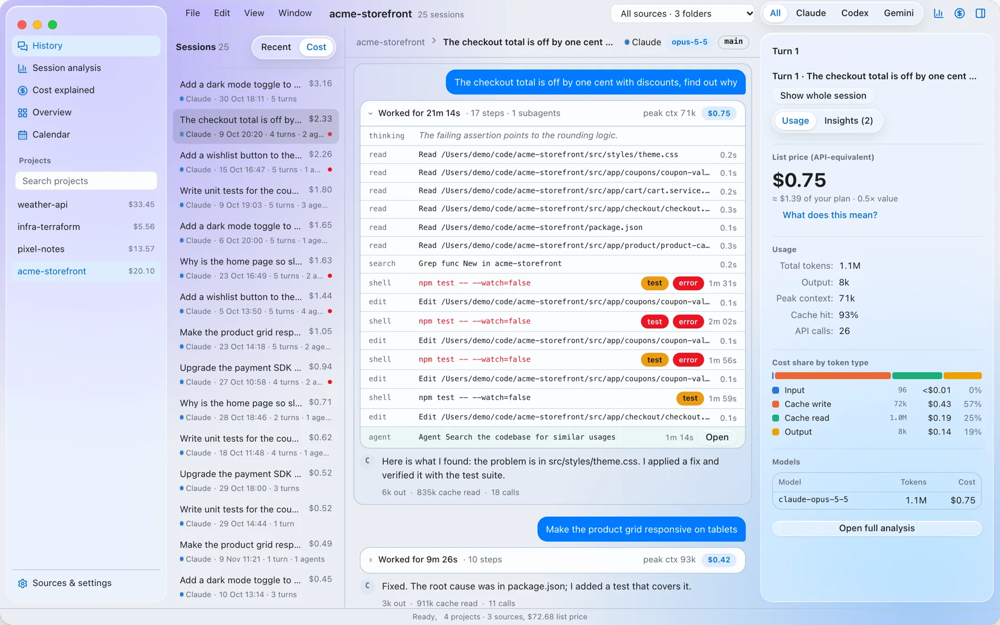

  

<h1 align="center">Claudealyzer</h1>

  <strong>See where your coding agent's tokens, time and money go.</strong> 
  A local, read-only desktop app for Claude Code, Codex CLI and Gemini CLI history.  
  <a href="https://molnarroland.github.io/Claudealyzer/"><strong>Website</strong></a> ·
  <a href="#installation"><strong>Download</strong></a> ·
  <a href="DEVELOPMENT.md"><strong>Build from source</strong></a>

  
  
  
  
  
  
  

  

---

Coding agents write a detailed transcript of every session to your home folder. Claudealyzer reads
those transcripts and turns them into something you can reason about: which projects, sessions,
prompts, tool calls and subagents cost the most, why they cost that much, and what you could change.

- **Local only.** No account, no telemetry, no network calls. Your transcripts never leave your machine.
- **Read-only.** It never writes into an agent's folder.
- **Live.** Sources are rescanned every 15 seconds, so a running session updates as you work.

## Built with

- **[Go](https://go.dev) + [Wails v3](https://v3.wails.io).** The parsing, indexing, pricing and insight
  engine is written in Go. Wails turns it into a small native desktop binary.
- **The operating system's own web renderer.** There is no bundled Chromium as in Electron. The UI runs in the
  web view the OS already ships: WebKit (WKWebView) on macOS, WebKitGTK on Linux and WebView2 on Windows.
  That keeps the app small and quick to start, and it uses little memory.
- **Angular + [Spartan Native](https://github.com/Spartan-Native/spartan-native)**, my native-look theme for
  [spartan/ui](https://spartan.ng). One Angular codebase gets the geometry, materials and behaviour of each OS,
  and it reads the user's real system settings (accent color, light/dark mode, contrast, text size) through
  the [Wails host adapter](https://github.com/Spartan-Native/host-wails).

## Supported agents

| Agent | Location | Status |
|---|---|---|
| Claude Code | `~/.claude*` (multiple profiles supported) | ✅ Supported |
| Codex CLI / Codex Desktop | `~/.codex` | ✅ Supported |
| Gemini CLI | `~/.gemini` | ✅ Supported |
| OpenCode | `~/.local/share/opencode` | 🔍 Detected, not read yet |

On first start Claudealyzer detects agent folders in your home directory and adds them as sources.
You can add more folders (e.g. a copied profile or a second machine's backup) at any time.

## Features

### History — browse every session like a chat

- **Projects → sessions → conversation** in a three-pane layout.
- Each turn shows your prompt, the agent's answer, and the **steps in between** collapsed into a
  readable list: thinking, shell commands, file reads/edits, web calls, MCP tools and subagents.
- **Subagents** open inline with their own steps, usage and cost.
- **Usage & insights panel** on the right, scoped to the whole session, a selected turn, or a subagent:
  tokens by type, list price, your cost, and the findings that apply.
- Copy session ID, jump to analysis or the cost breakdown from any session.

### Step detail — what one tool call really did

- Full command or input, and the full output.
- Wall time, tokens the output added to the context, how often the same step was repeated.
- Related insight findings for that step.

### Session analysis — why a session was expensive

- **Cost per turn** stacked by token type (input, cache write, cache read, output).
- **Peak context per turn** to spot context growth and missed compactions.
- **Time breakdown**: model time vs. tools vs. waiting.
- **Ranked cost drivers**, slowest commands and most-read files.

### Overview — all sessions at a glance

- Daily list price per agent for the last 7 days, 30 days or all time.
- Sortable session table with finding badges, filtered to one project or the whole source.

### Calendar — your usage by day

- Month calendar coloured by **cost, prompts or tokens** per day.
- Click a day for its KPIs, cost by hour, token split, models used, sessions and every prompt of that day.
- Keyboard navigation between days and months.

### Cost explained — list price vs. what you actually pay

- **List price** vs. **your cost** vs. **value multiplier** (how much API value your plan gave you).
- The full token × rate calculation, per model.
- Price scenarios and billing period vs. plan fee.

### Insights — concrete, ranked suggestions

Every session, turn and subagent is checked against a set of rules. Each finding carries a severity
and an estimated dollar impact, so the most expensive problems come first.

| Rule | What it flags |
|---|---|
| Context too large / growing | Turns that re-send a very large cached context |
| Long session without compaction | Sessions where context kept growing instead of being compacted |
| Large tool output | Single tool results that bloat the context |
| Many / too many files read, files read again | Broad or repeated file reading |
| Errors and retries | Failing commands in a row |
| Slow test and build runs | Commands that dominate wall time |
| Repeated command | The same command run again and again |
| CPU-heavy commands | Commands that keep the machine busy |
| Subagent fan-out, expensive subagents | Subagents that cost more than they return |
| Large model on small steps | Expensive models used for trivial turns |
| Cache churn / cache healthy | Cache writes that are not reused (or confirmation that they are) |
| Estimate differs from Claude Code's total | Where Claude Code's own `cost-state` total disagrees with the estimate |

All thresholds are editable under **Sources & settings**.

### Sources & settings

- Detected sources and their status; add, remove and rescan folders.
- **Billing per source**: API key (with optional discount), subscription, team seat or free tier.
- A **versioned pricing table**: rates are applied by the date of each request, so price changes don't
  rewrite history. Edit it, or reset it to the built-in table.
- Insight thresholds.

### Native look on every platform

The UI uses [Spartan Native](https://github.com/Spartan-Native/spartan-native), so it looks like the
operating system it runs on. On macOS you get a unified toolbar, traffic lights and sheets. On Windows you get
a Windows 11 title bar and controls, and on Linux a GNOME/GTK (libadwaita-style) header bar. It follows the system's accent color, light/dark mode, contrast and text
size, and it has a full menu bar and keyboard shortcuts. Under **Sources & settings → Appearance** you can pick
another look (Windows 11/10, macOS 26/13–15, GNOME, KDE Plasma, ChromeOS) or force light or dark mode.

| Shortcut | Action |
|---|---|
| <kbd>⌘/Ctrl</kbd> <kbd>1</kbd>…<kbd>5</kbd> | History, Session analysis, Cost explained, Overview, Calendar |
| <kbd>⌘/Ctrl</kbd> <kbd>,</kbd> | Sources & settings |
| <kbd>⌘/Ctrl</kbd> <kbd>⇧</kbd> <kbd>N</kbd> | Add source |
| <kbd>⌘/Ctrl</kbd> <kbd>⇧</kbd> <kbd>R</kbd> | Rescan sources |
| <kbd>⌘/Ctrl</kbd> <kbd>⌥/Alt</kbd> <kbd>I</kbd> | Toggle the usage & insights panel |

## How the numbers are calculated

- **Each API response is counted once** (Claude: by `message.id`; Codex: by `response_id`; Gemini: by message id),
  even if it appears several times in a transcript.
- **Usage is normalised** to: uncached input, cache write (5 min / 1 h), cache read, and output (including thinking).
  Codex and Gemini report cached tokens as part of input, so uncached = input − cached.
- **List price** = Σ tokens × rate for each model, using the rate valid on the day of the request.
  Unknown models are shown as *price unknown*, never as $0.
- **Your cost** depends on the source's billing:
  - API key: list price, minus your discount;
  - subscription / team seat: plan fee × this usage's share of the billing period's list price for that source;
  - free tier: $0.
- Where Claude Code wrote a `cost-state` record, its own total is shown next to the estimate.
- With *All sources* selected, a session found in two folders (e.g. a copied profile) is counted once.

> Costs are **estimates** based on public list prices. They are useful for comparing sessions and spotting
> waste, not as an invoice.

## Installation

Download the build for your platform from the [Releases](../../releases) page:

| Platform | File |
|---|---|
| macOS (Apple Silicon + Intel) | `claudealyzer-universal.zip` → `Claudealyzer.app` |
| Windows | `claudealyzer.exe.zip` or the NSIS installer |
| Linux | AppImage, `.deb` or `.rpm` |

> **macOS:** the app is ad-hoc signed, not notarized. On first launch right-click the app and choose
> **Open**, or run `xattr -dr com.apple.quarantine /Applications/Claudealyzer.app`.

Or build it yourself — see [DEVELOPMENT.md](DEVELOPMENT.md).

## Where Claudealyzer stores its own data

| What | Where |
|---|---|
| Sources, billing, thresholds | `<user config dir>/claudealyzer/config.json` |
| Your edited pricing table | `<user config dir>/claudealyzer/pricing.json` |
| Summary cache | `<user cache dir>/claudealyzer/index.json` |

`<user config dir>` is `~/Library/Application Support` on macOS, `%AppData%` on Windows and `~/.config` on Linux;
`<user cache dir>` is `~/Library/Caches`, `%LocalAppData%` and `~/.cache` respectively.
Deleting these folders resets the app; your agent transcripts are not affected.

## Contributing

Bug reports, new agent adapters and pricing updates are welcome. Read **[CONTRIBUTING.md](CONTRIBUTING.md)**
first; developer setup, project layout, tests and packaging are described in **[DEVELOPMENT.md](DEVELOPMENT.md)**.
This project follows the [Contributor Covenant](CODE_OF_CONDUCT.md). Changes are listed in [CHANGELOG.md](CHANGELOG.md).

## Security

Found a vulnerability? Please report it privately, see **[SECURITY.md](SECURITY.md)**.

## License

[MIT](LICENSE) © 2026 Roland Molnár

## Disclaimer

Claudealyzer is an independent project. It is not affiliated with, endorsed by or sponsored by
Anthropic, OpenAI or Google. Claude, Claude Code, Codex and Gemini are trademarks of their respective owners.
